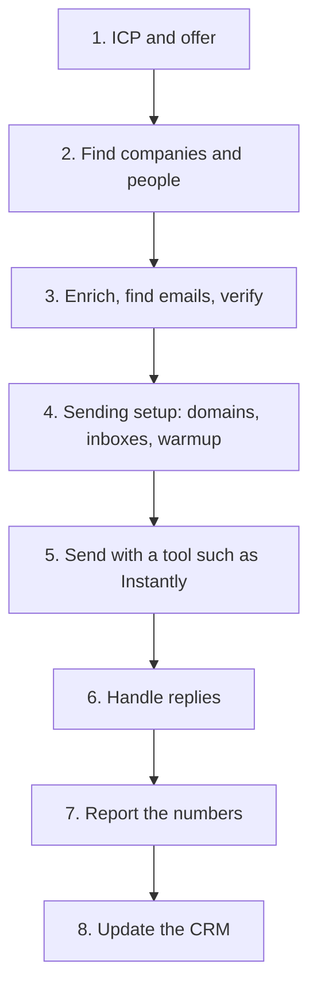
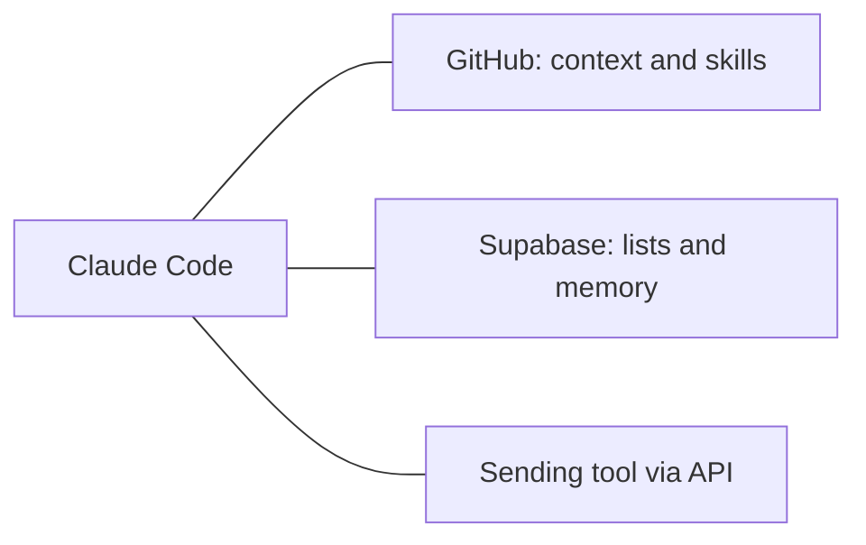

# How a cold outbound system fits together

This is the bigger picture. Today's homework is Level 1 (this repo). You do not need to build the whole system this week. Read this when you want to understand how the pieces connect, and where Claude Code, GitHub, and Supabase sit.

Cold outbound means you write to people who do not know you yet, with a relevant offer, and you do it in a repeatable way. The system is just a pipeline: decide who and what, find them, get a good email, send safely, handle replies, then learn from the numbers.

## The map

Context sits beside the pipeline, not inside one step. Claude Code reads your files, GitHub stores those files, and Supabase can store the data you collect, so you do not start from zero each time.

## The pieces, in plain words

**1. ICP and offer.** ICP means ideal customer profile: the kind of company and the job title you want. The offer is what you are actually putting in front of them. Get these clear first. A great list with a weak offer still gets ignored. In this repo, that lives in `client.md`. Use `new-client`, then `offer-builder`.

**2. Data sources.** You need companies and people. That can be free public research, a tool like Clay, or a database you already have. `list-builder` does the small version. Clay is the usual next step when you want bigger, cleaner lists.

**3. Enrichment, email finding, and verification.** A name and a company are not enough to send. Enrichment adds facts (size, location, a role). Email finding looks up a work email. Verification checks that the inbox is real, so you bounce less. Never guess or invent emails. Use a real finder and a verifier.

**4. Sending infrastructure.** This is the plumbing that keeps mail out of spam.

- **Domains:** you send from a domain you own, usually not your main website domain.
- **Inboxes:** real mailboxes on that domain.
- **SPF, DKIM, and DMARC:** DNS records that prove the email is allowed to come from you. Your sending tool or domain host will show you what to add.
- **Warmup:** you start with a low daily volume and build up, so new inboxes look like normal people, not a blast.

**5. The sending tool (Instantly is one example).** This is where the campaign lives: the list, the sequence, the daily limits, and the inbox rotation. Other tools exist. The idea is the same. Once you are ready, you connect the tool to Claude or to a small script with an API key.

**6. Reply handling.** Someone writes back. A person should see it. Out of office and other automatic messages are not a real conversation. Positive replies (they want a call, a price, or more details) need a fast, human follow up. Many teams also log this in a CRM.

**7. Reporting.** After you send, you look at a few basic numbers: sent, bounce rate, reply rate, positive replies, meetings. The `/report` skill in this repo is a simple version you can run from a CSV or pasted totals. Later you can pull numbers from the sending tool automatically.

**8. CRM.** A place you keep people, companies, and what happened (replied, meeting booked, customer). It stops you emailing the same person twice and helps you follow up. A spreadsheet is fine at the start. A CRM is the neater version.

## Where Claude Code, GitHub, and Supabase sit

- **Claude Code** is the operator. It reads your context, runs skills, and helps you build lists, offers, copy, and reports.
- **GitHub** is the filing cabinet. `client.md`, skills, handoffs, lists, and copy live in a repo, so the context is not stuck in one chat.
- **Supabase** is optional memory for data: companies and people you have already found, so you do not research the same company twice.

They do not replace Clay, Instantly, or a CRM. They hold the context and the memory that make those tools work together.

## Connecting a sending tool with an API key

When you reach Level 3, you can let Claude or a script talk to Instantly (or a similar tool) through an API. An API is just a way for two programs to talk. An API key is the password that proves it is you.

Do it safely:

- Never paste a key into the chat.
- Never commit a key to GitHub.
- Put keys in a `.env` file in the project folder (a plain text file of `NAME=value` lines).
- `.env` is already in `.gitignore`, so Git will not upload it. Check that before you commit.
- If a key does leak, revoke it in the tool and create a new one.

## The levels (a roadmap)

**Level 1: this repo, today.** Write `client.md`, tighten the offer, build a small list, plan a campaign, write 3 emails, and run `/handoff`. No paid sending setup required.

**Level 2: Clay lists.** Connect Clay and pull companies and people that match your ICP, still without guessing emails in this repo.

**Level 3: connect a sending tool API.** You have domains, inboxes, and warmup in a tool like Instantly. You store the API key in `.env` and let Claude help you upload a list or read basic campaign numbers.

**Level 4: an automated loop.** New companies flow in, enrichment and sending happen on a schedule, replies are labelled, and a report lands in your inbox or Slack. This is a later build. Get Levels 1 to 3 solid first.

When you are unsure what to do next, finish the Level you are on before adding a new tool.
